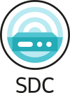

# Community

Find out everything about the SDC community.

## Discord

Everybody is welcome to join and chat with our community members about all things SDC!

## Community Meetings

We have a community meeting every Monday from 8:30h CET on Zoom. You can subscribe to the meeting from our
[community calendar](https://zoom-lfx.platform.linuxfoundation.org/meetings/schema-driven-configuration?view=week).

Meeting recording are published on the [Kubenet YouTube channel](https://www.youtube.com/@kubenet-wq9nt).

## Raise issues

If you would like to have a new feature or found a blog submit them to the issues of the respective repository in the
[sdcio GitHub organization](https://github.com/sdcio). If you do not know which repo to use of have a generic feature
request or bug add them to the [.github repo](https://github.com/sdcio/.github/issues).

## Contribute

Contributions are welcome feel free to raise Pull Requests against any of the repos.

## Talks about SDC

* [Conference recordings](https://learn.kubenet.dev/03-videos/01_videos/#sdc)

## Logos

Logos of SDC in different formats:

* [SDC_transparent 100x100.png](../assets/logos/SDC-transparent-noname-100x100.png)
* [SDC_transparent 511x511.png](../assets/logos/SDC-transparent-noname-511x511.png)
* [SDC_transparent.png](../assets/logos/SDC-transparent-withname-100x133.png)
* [SDC_transparent 511x680.png](../assets/logos/SDC-transparent-withname-511x680.png)
* [SDC_logo.svg](../assets/logos/SDC-logo.svg)
